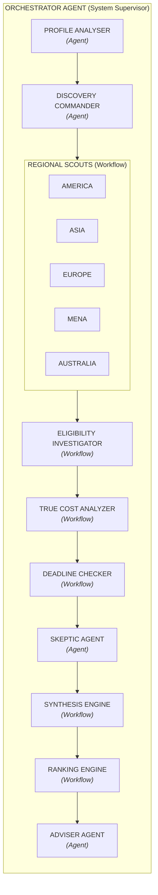

# ScholarX

Autonomous multi-agent scholarship intelligence and admissions counseling system.

ScholarX pairs deterministic validation logic with a multi-agent backend to evaluate applicants against 310 curated scholarship programs worldwide. It is built specifically with Pakistani academic credentials (BISE Matric/FSc, Cambridge O/A-Levels, IBCC equivalence, and HEC-recognized university tiers) and realistic Pakistani Rupee (PKR) living expense modeling.

---

## Table of Contents

- [Core Design](#core-design)
- [System Architecture](#system-architecture)
- [Quickstart](#quickstart)
- [Configuration and Environment Variables](#configuration-and-environment-variables)
- [Developer Commands](#developer-commands)
- [Repository Structure](#repository-structure)
- [Database and Offline Execution](#database-and-offline-execution)
- [Troubleshooting](#troubleshooting)
- [License](#license)

---

## Core Design

ScholarX avoids common LLM pitfalls by separating math and rules from language generation:

1. **Deterministic logic for rules and finances**: Hard eligibility checks (minimum GPA, degree requirements, language score cutoffs, and testing deadlines) and cost calculations (stipends vs. local PKR visa, flight, and living expenses) run as pure Python code in `backend/workflows/`. LLMs are never asked to calculate numbers or make up policy rules.
2. **LLMs for qualitative analysis**: Agent calls in `backend/agents/` handle qualitative tasks: parsing resumes and student background, summarizing selection criteria, red-teaming profile weaknesses, and drafting personalized preparation roadmaps.
3. **Pakistan localization**: Includes Pakistani credential conversions (such as Cambridge grades to IBCC percentage equivalents) and localized cost projections in Pakistani Rupees using `data/pakistan_costs.json` and `data/pakistan_education.json`.
4. **Command Theatre frontend**: A Next.js 15 interface built with Tailwind CSS and Zustand, featuring an interactive D3-Geo world projection map, live Server-Sent Events (SSE) telemetry, and PDF dossier generation.

---

## System Architecture

ScholarX executes admissions intelligence through a structured pipeline supervised by an Orchestrator Agent. The architecture separates qualitative reasoning (**Agents**, powered by LLMs) from deterministic calculations (**Workflows**, executed in Python):



```text
┌────────────────────────────────────────────────────────────────────────┐
│                          ORCHESTRATOR AGENT                            │
│                                                                        │
│                      ┌──────────────────────┐                          │
│                      │   PROFILE ANALYSER   │ ──► AGENT                │
│                      └──────────┬───────────┘                          │
│                                 ▼                                      │
│                      ┌──────────────────────┐                          │
│                      │ DISCOVERY COMMANDER  │ ──► AGENT                │
│                      └──────────┬───────────┘                          │
│                                 ▼                                      │
│         ┌────────────────────────────────────────────────────┐         │
│         │                      WORKFLOW                      │         │
│         │ ┌─────────┐ ┌──────┐ ┌────────┐ ┌──────┐ ┌───────┐ │         │
│         │ │ AMERICA │ │ ASIA │ │ EUROPE │ │ MENA │ │AUSTRAL│ │         │
│         │ └─────────┘ └──────┘ └────────┘ └──────┘ └───────┘ │         │
│         └───────────────────────┬────────────────────────────┘         │
│                                 ▼                                      │
│                      ┌──────────────────────┐                          │
│                      │ELIGIBILITY INVESTIGAT│ ──► WORKFLOW             │
│                      └──────────┬───────────┘                          │
│                                 ▼                                      │
│                      ┌──────────────────────┐                          │
│                      │  TRUE COST ANALYZER  │ ──► WORKFLOW             │
│                      └──────────┬───────────┘                          │
│                                 ▼                                      │
│                      ┌──────────────────────┐                          │
│                      │   DEADLINE CHECKER   │ ──► WORKFLOW             │
│                      └──────────┬───────────┘                          │
│                                 ▼                                      │
│                      ┌──────────────────────┐                          │
│                      │    SKEPTIC AGENT     │ ──► AGENT                │
│                      └──────────┬───────────┘                          │
│                                 ▼                                      │
│                      ┌──────────────────────┐                          │
│                      │   SYNTHESIS ENGINE   │ ──► WORKFLOW             │
│                      └──────────┬───────────┘                          │
│                                 ▼                                      │
│                      ┌──────────────────────┐                          │
│                      │    RANKING ENGINE    │ ──► WORKFLOW             │
│                      └──────────┬───────────┘                          │
│                                 ▼                                      │
│                      ┌──────────────────────┐                          │
│                      │    ADVISER AGENT     │ ──► AGENT                │
│                      └──────────────────────┘                          │
└────────────────────────────────────────────────────────────────────────┘
```

### Pipeline Components

| Stage | Classification | Responsibility |
| :--- | :--- | :--- |
| **Orchestrator Agent** | Agent (Director) | Oversees the full pipeline, coordinates state transitions, and manages SSE telemetry streams. |
| **Profile Analyser** | Agent | Extracts candidate academic credentials, normalizes Pakistani grading systems (BISE/FBISE), Cambridge A-Levels, and English requirements. |
| **Discovery Commander** | Agent | Translates normalized candidate goals into targeted regional queries across scholarship databases and search scrapers. |
| **Regional Scouts** | Workflow | Five parallel pipelines scanning 310+ deep dossiers across America, Asia, Europe, MENA, and Australia. |
| **Eligibility Investigator** | Workflow | Applies deterministic 15-dimension audits to verify hard requirements: HEC degree recognition, 16-year equivalence, GPA cutoffs, and age caps. |
| **True Cost Analyzer** | Workflow | Calculates 4-phase expenses in Pakistani Rupees (PKR): initial test fees, visa and embassy costs, airfare, and settling-in allowances versus official stipends. |
| **Deadline Checker** | Workflow | Calculates application runways, dual-gate deadlines (HEC nomination vs university deadline), and visa appointment lead times. |
| **Skeptic Agent** | Agent | Red-teams candidate applications to identify risk factors, return-to-home bonds, hidden bench fees, and competition bottlenecks. |
| **Synthesis Engine** | Workflow | Merges deterministic eligibility and cost data with qualitative risk alerts into a structured evaluation payload. |
| **Ranking Engine** | Workflow | Calculates an 8-factor composite match index (0-100) based on eligibility match, PKR financial burden, acceptance likelihood, and deadline feasibility. |
| **Adviser Agent** | Agent | Formulates an actionable roadmap, personalized milestone calendar, document preparation guide, and contingency options. |

---

## Quickstart

Follow these steps to run ScholarX locally.

### Prerequisites

- **Node.js**: v18.0.0 or later (v20+ recommended)
- **Python**: v3.11 or v3.12
- **Git**

### 1. Clone the repository

```bash
git clone https://github.com/Hamza-Gohar/ScholarX.git
cd ScholarX
```

### 2. Install dependencies

Install frontend dependencies:

```bash
cd frontend
npm install
cd ..
```

Create a Python virtual environment and install backend packages:

```bash
python3 -m venv .venv
source .venv/bin/activate       # On Windows: .venv\Scripts\activate
pip install -r requirements.txt
```

### 3. Configure environment variables

Copy the sample environment file:

```bash
cp .env.example .env
```

Open `.env` and add at least one API key for Gemini or Groq:

```env
GEMINI_API_KEY_1=your_gemini_key_here
# or
GROQ_API_KEY_1=your_groq_key_here
```

ScholarX supports round-robin key rotation across up to 13 Groq keys and 3 Gemini keys to prevent rate limit bottlenecks.

### 4. Start the application

Run both the FastAPI backend and Next.js frontend with one command:

```bash
npm run dev
# or
make dev
```

The application runs on:

- **Frontend interface**: http://localhost:3000
- **Interactive API documentation (Swagger)**: http://localhost:8000/docs
- **Health check endpoint**: http://localhost:8000/api/health

---

## Configuration and Environment Variables

| Variable | Description | Example | Required |
| :--- | :--- | :--- | :---: |
| `GEMINI_API_KEY_1..3` | Google Gemini keys for deep analysis | `AIzaSy...` | Optional* |
| `GEMINI_PRIMARY_MODEL` | Primary Gemini model identifier | `gemini-2.5-flash` | No |
| `GROQ_API_KEY_1..13` | Groq keys for low-latency reasoning | `gsk_...` | Optional* |
| `GROQ_MODEL` | Default Groq model | `llama-3.3-70b-versatile` | No |
| `TAVILY_API_KEY_1..7` | Tavily keys for live web search | `tvly-...` | No (Cached) |
| `FIRECRAWL_API_KEY_1..6` | Firecrawl keys for deep URL scraping | `fc-...` | No (Cached) |
| `SESSION_DB_PATH` | Path to the local SQLite database | `./data/scholarx_sessions.db` | No |

\*At least one working LLM API key (Gemini or Groq) is required to run live multi-agent counseling.

---

## Developer Commands

The project root provides shortcuts via `Makefile` and `npm`:

| Command | Action |
| :--- | :--- |
| `make dev` or `npm run dev` | Starts FastAPI (port 8000) and Next.js (port 3000) concurrently |
| `make backend` | Starts the FastAPI backend with hot-reload enabled |
| `make frontend` | Starts the Next.js development server |
| `make doctor` or `npm run doctor` | Runs the 48-point environment and database diagnostic suite |
| `make test-fast` | Runs unit tests for schemas and API key rotation (<0.5s) |
| `make test` | Runs the full pytest test suite |
| `make seed` | Seeds SQLite with 310 scholarships and benchmark student profiles |
| `make primer` | Prints a high-density architectural overview (~1,500 tokens) |

---

## Repository Structure

```text
SCHOLARX/
├── backend/
│   ├── agents/            # Scout, Evaluator, Skeptic, and Roadmap agent implementations
│   ├── api/               # FastAPI route definitions (sessions, scholarships, students)
│   ├── db/                # SQLite database models, connection handlers, and seed logic
│   ├── events/            # Server-Sent Events (SSE) streaming engine
│   ├── graph/             # 10-node LangGraph StateGraph orchestration
│   ├── schemas/           # Pydantic v2 schemas and validation contracts
│   ├── tests/             # Pytest test suites (security, schema, workflows)
│   ├── tools/             # Search clients, scrapers, and document parsers
│   └── workflows/         # Deterministic scoring, checklist logic, and ranking algorithms
├── frontend/
│   ├── app/               # Next.js 15 App Router pages and API routes
│   ├── components/        # UI components (Command Theatre, Stage, D3 projection)
│   ├── hooks/             # React hooks (useSSE, useScholarships)
│   ├── lib/               # Utility functions, sound effects, and API client
│   └── store/             # Zustand v5 state stores
├── data/
│   ├── scholarships/      # 310 scholarship JSON dossiers grouped by region
│   ├── pakistan_costs.json       # Pakistan cost benchmarks (visas, flights, living)
│   └── pakistan_education.json   # BISE / IBCC / HEC conversion tables
├── docs/                  # Architecture Decision Records (ADRs) and reference notes
├── exhibition_slides/     # Presentation deck and PDF builder
├── scripts/               # Diagnostics (doctor.py), context engine, and database curators
├── Makefile               # Task runner shortcuts
├── package.json           # Node scripts and runner configuration
├── requirements.txt       # Root Python dependency specification
└── README.md              # Project documentation
```

---

## Database and Offline Execution

ScholarX uses a local, single-file SQLite database with Write-Ahead Logging (WAL) enabled (`data/scholarx_sessions.db`).

The deterministic matching engine, Pakistan equivalence conversions, offline scholarship catalog (310 dossiers), and database viewer work without third-party services or network calls. External network calls occur only when requesting live web scraping or when invoking LLM agents for conversational counseling.

To test the system offline:

```bash
# Verify the scholarship catalog
python3 scratch/query_scholarships.py

# Launch the offline database viewer in your browser
xdg-open scholarships_database_viewer.html
```

---

## Troubleshooting

### Port 8000 or 3000 is already in use

If port 8000 is busy, start FastAPI on another port:

```bash
PYTHONPATH=backend .venv/bin/python -m uvicorn main:app --port 8080 --reload
```

If port 3000 is busy, tell Next.js to use port 3001:

```bash
cd frontend && npm run dev -- -p 3001
```

### Running the environment doctor

Run `doctor.py` to identify missing packages, missing files, or port conflicts:

```bash
.venv/bin/python scripts/doctor.py
```

### Python packages not detected

Make sure you run scripts using the virtual environment interpreter (`.venv/bin/python`) rather than your global system Python.

---

## License

Released under the [MIT License](LICENSE).
